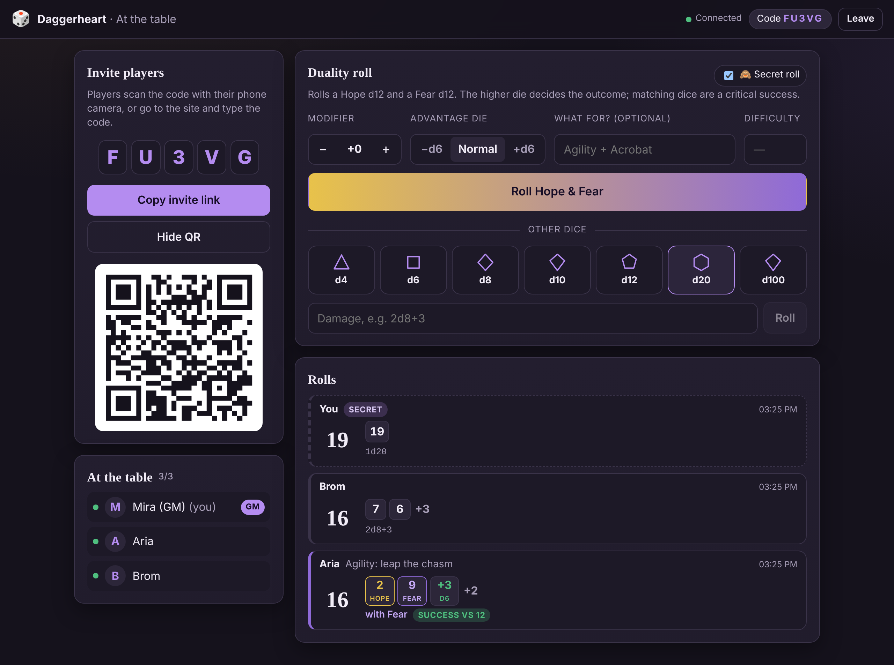

# Table of Heroes: D&D + Daggerheart

A web app for playing **D&D 5e** and **Daggerheart** with friends, online (e.g. over Discord) or around a table with everyone on their own phone or laptop.



## What works now (Step 1: lobby and shared dice)

- **Lobbies.** The GM creates a lobby, picks the game (D&D 5e or Daggerheart) and how you're playing:
  - **Online:** copy an invite link to paste in Discord.
  - **At the table:** players scan a QR code or type the 5-letter code.
- **Shared dice.** Every roll appears for everyone in the lobby, rolled on the server so nobody can fudge it.
  - **D&D:** d20 rolls with modifier, advantage/disadvantage, DC check, natural 20/1 callouts.
  - **Daggerheart:** duality rolls (Hope d12 + Fear d12), ±d6 advantage, difficulty check, "with Hope" / "with Fear" / critical success.
  - Quick d4–d100 buttons and free-form rolls like `2d6+1d4+3` or `4d6kh3` (keep highest 3).
  - **Secret rolls** for the GM only.
- **Rejoin.** Refreshing the page or a dropped phone connection puts you back in your seat.

Lobbies are kept in memory for now, so restarting the server clears them. Saving characters and maps will add a database in a later step.

## Roadmap

1. ✅ Lobby and shared dice
2. Character sheets for both games (create, plus import)
3. Shared interactive map (tokens, grid, fog of war)
4. Combat and GM tools (D&D initiative, Daggerheart spotlight and Fear tracker, GM notes)

## Run it on your computer

Needs [Node.js](https://nodejs.org) 20 or newer.

```bash
npm install
npm run dev
```

Open http://localhost:5173. To test with friends on the same Wi-Fi, they open `http://<your-computer's-IP>:5173` (Vite prints the address as "Network").

## Put it online for free

The repo includes a `render.yaml`, so on [Render](https://render.com) you can choose **New → Blueprint**, pick this repo, and it builds and starts by itself. Any Node host works:

```bash
npm ci
npm run build   # builds the web app into dist/
npm start       # serves the app and the realtime server on $PORT (default 3001)
```

Free hosts usually sleep when idle, so the first visit after a while can take ~30 seconds, and sleeping clears the in-memory lobbies.

## Project layout

```
shared/     Types and the dice engine (shared by server and browser)
server/     Express + Socket.IO server, lobby store
src/        React web app (Vite)
tests/      Vitest unit tests for the dice rules
```

Scripts: `npm test`, `npm run typecheck`, `npm run build`.

## Rules content

Game rules come from the publicly released SRDs: the D&D 5e SRD (CC-BY-4.0) and the Daggerheart SRD under the Darrington Press Community Gaming License. This is a fan project and isn't affiliated with Wizards of the Coast or Darrington Press.
